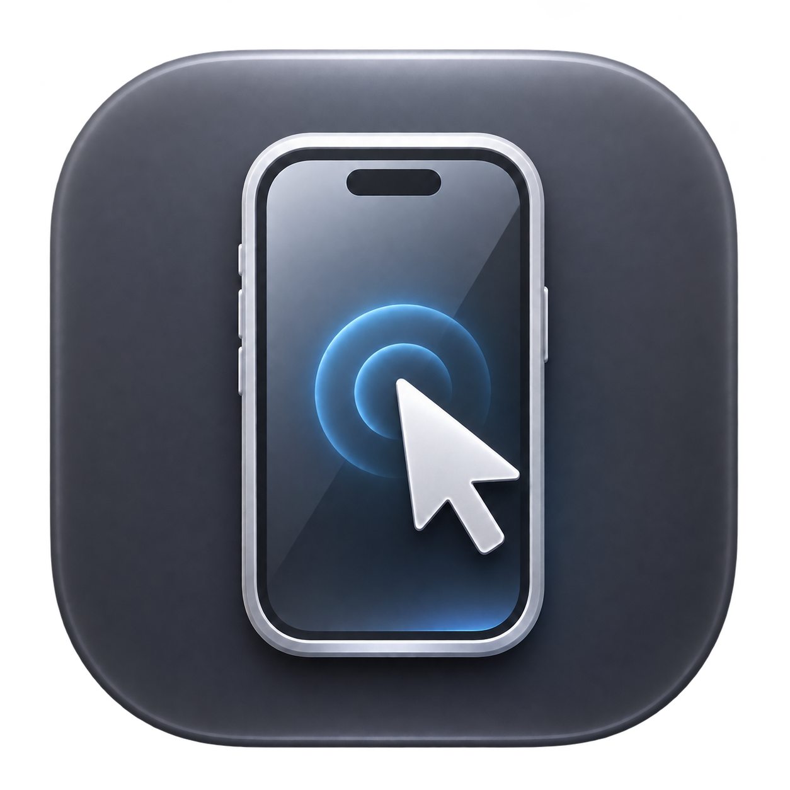

# iPhone Remote

[English](README.md) · **Italiano**



App nativa macOS in Swift e SwiftUI per vedere e controllare un iPhone collegato
via USB. Utile anche quando il display fisico non è utilizzabile ma il telefono
può ancora essere sbloccato e autorizzato.

**Anteprima per sviluppo locale · versione 0.5.0.** Non è un prodotto App Store,
non aggira il codice dell’iPhone e non offre controllo remoto via Internet.
Il video usa API pubbliche macOS; il controllo richiede il runner separato
**WebDriverAgent (WDA), che utilizza API private XCTest**.

## Funzioni

- Video USB AVFoundation, mantenimento delle proporzioni e finestra ridimensionabile.
- Clic, swipe, rotella, pressione lunga e digitazione con composizione macOS.
- Pillole sottili sopra orario e indicatori per notifiche e Centro di Controllo;
  un comando centrato in basso: clic per Home, doppio clic per app aperte.
- Invio nelle chat supportate quando viene riconosciuto un unico pulsante Invia;
  ⇧Invio per andare a capo. La compatibilità dipende dall’app e dalla lingua.
- Modalità compatta, primo piano, scorciatoie personalizzabili e pulsanti regolabili.
- Screenshot PNG e registrazioni MOV H.264 locali, senza audio.
- Riconnessione con attese crescenti, senza reinviare input dall’esito incerto.
- Avvio del runner personale, stato del provisioning e tentativo di rinnovo via Xcode.
- Guida numerica **indicativa e manuale** per tastierini nascosti: non rileva i tasti
  reali, non inserisce codici e sospende il controllo remoto mentre è visibile.

## Requisiti e compatibilità

| Componente | Requisito |
| --- | --- |
| Mac | Target minimo macOS 14; prova fisica eseguita su Apple Silicon, macOS 27.2 |
| Xcode | Installazione completa compatibile con la versione iOS del dispositivo |
| iPhone | Cavo dati USB, fiducia nel Mac, Modalità sviluppatore e automazione UI abilitate |
| Firma WDA | Apple Account configurato in Xcode e provisioning valido per il proprio iPhone |
| Strumenti locali | Git, Python 3 e `iproxy` da libusbmuxd |

La prova di riferimento usa iPhone 14 Pro, iOS 27.2 e Xcode 27.2. Altri modelli,
versioni e Mac Intel non sono dichiarati collaudati. Il target macOS 14 è una
impostazione di build, non una prova su ogni sistema supportato.

Il progetto non richiede abbonamenti o servizi cloud per video e controllo.
Firma e rinnovo del runner possono contattare i servizi Apple; il Personal Team
ha limiti e scadenze. Ogni utente prepara il proprio runner: **non distribuire la
copia personale firmata come se fosse un’app universale**.

## Installazione personale

1. Scarica i sorgenti da questo repository e apri Terminale nella cartella.
2. Installa Xcode, aggiungi il tuo Apple Account in **Xcode → Settings → Accounts**,
   collega e autorizza l’iPhone. Su iPhone abilita Modalità sviluppatore e,
   se presente, **Impostazioni → Sviluppatore → Enable UI Automation**.
3. Installa il tunnel USB:

   ```sh
   brew install libusbmuxd
   ```

4. Prepara la configurazione locale, che viene esclusa da Git:

   ```sh
   mkdir -p .local
   cp Config/Local.env.example .local/development.env
   ```

   Modifica `.local/development.env` con il tuo UDID, Team ID e identificativo
   runner univoco. Non pubblicare il file compilato. Per trovare questi valori
   e risolvere problemi di firma leggi [la guida di installazione](Docs/PERSONAL-APP.md).

5. Carica la configurazione e prepara la tua app:

   ```sh
   source .local/development.env
   Scripts/setup-personal-app.sh
   open '/Applications/iPhone Remote.app'
   ```

Lo script scarica una revisione WDA fissata, compila il runner con il tuo Team,
prepara una copia Mac firmata e la installa in Applicazioni. Può richiedere
interventi in Xcode e conferme fisiche sull’iPhone. All’avvio, l’app prepara video,
tunnel e runner. Non cambia `xcode-select` e non installa servizi di login.

## Compilare solo l’app Mac

Non servono iPhone, account Apple o runner per compilare l’interfaccia e i test:

```sh
Scripts/build-app.sh
open 'build/mac/Build/Products/Debug/iPhone Remote.app'
```

Oppure apri `iPhoneRemote.xcodeproj`, schema **iPhoneRemote**, destinazione **My Mac**.
La build Debug è firmata ad hoc; senza il pacchetto personale non avvia da sola
WDA. Per il controllo manuale vedi [la guida](Docs/PERSONAL-APP.md#avvio-manuale-per-sviluppatori).
Per Xcode installato altrove, imposta `DEVELOPER_DIR` sulla sua cartella
`Contents/Developer` prima di eseguire gli script.

## Verifiche

```sh
Scripts/verify.sh
python3 -m unittest discover -s Tests/Publication -v
Scripts/verify-experience.sh
```

- `verify.sh`: 19 test RemoteCore, modello di input/riconnessione, build macOS e firma ad hoc.
- Test Publication: verifica del controllo dei file destinati alla pubblicazione.
- `verify-experience.sh`: richiede una sessione desktop Mac; usa dati sintetici
  per input, scorciatoie, geometria, PNG e MOV. Non invia messaggi all’iPhone.

GitHub Actions esegue test, audit dei sorgenti e build Mac, senza iPhone né
credenziali di firma. I controlli del primo push sono passati su GitHub;
la CI non sostituisce le prove su hardware. Risultati locali e limiti:
[Docs/VERIFICATION.md](Docs/VERIFICATION.md).

## Uso e limiti

Clicca sul video per digitare. ⌃⌘S mostra/nasconde la sidebar. Le scorciatoie
predefinite ⌥⌘1–4 aprono Home, app aperte, notifiche e Centro di Controllo;
⌥⌘0 sospende/riprende il controllo; ⌥⌘5 salva uno screenshot; ⌥⌘6 registra/ferma.
Le opzioni e la cartella dei salvataggi sono nella sidebar.

Il video non proviene da QuickTime. Il successo di una sessione senza fotogrammi
non viene indicato come video funzionante. QuickTime o altre app possono occupare
la sorgente: la cattura simultanea non è garantita.

Supporto del controllo per **un solo iPhone USB**. Lo scroll è una serie di swipe,
non scroll nativo continuo. Audio, multitouch, uso senza Mac e collegamento diretto
con iPad non sono implementati. Schermate protette e richieste di autenticazione
possono nascondere tastiere o bloccare il controllo; devono essere completate
fisicamente. Nessun jailbreak, modifica a SIP o aggiramento delle protezioni.

La configurazione usa il proprio Apple Account; non condividere profili,
certificati, schermate personali o codici nelle issue. Il runner WDA è uno
strumento di sviluppo: leggi [SECURITY.md](SECURITY.md) prima di usarlo.

## Contribuire e distribuire

- [CONTRIBUTING.md](CONTRIBUTING.md): sviluppo e contributi.
- [CHANGELOG.md](CHANGELOG.md): funzioni della prima anteprima pubblicabile.
- [Docs/PUBLISHING.md](Docs/PUBLISHING.md): preparazione repository e archivio sorgenti.
- [Docs/TECHNICAL-ANALYSIS.md](Docs/TECHNICAL-ANALYSIS.md): architettura e dipendenze.

Codice originale sotto [licenza MIT](LICENSE). WDA e altri componenti mantengono
le proprie condizioni: [THIRD_PARTY_NOTICES.md](THIRD_PARTY_NOTICES.md).
Progetto indipendente, non affiliato né approvato da Apple, Appium o Meta.
