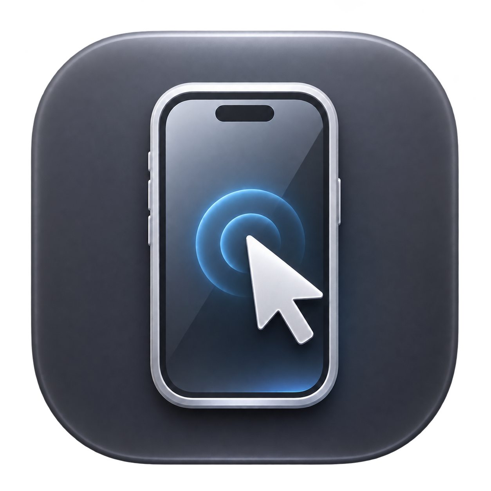

# iPhone Remote

**English** · [Italiano](README.it.md)



A native macOS app built with Swift and SwiftUI to view and control an iPhone
connected over USB. It can also help when the physical display is unusable,
provided the phone can still be unlocked and authorized.

**Local development preview · version 0.5.0.** This is not an App Store product,
does not bypass the iPhone passcode, and does not provide remote control over the
Internet. Video capture uses public macOS APIs; control requires a separate
**WebDriverAgent (WDA) runner, which uses private XCTest APIs**.

## Features

- USB video through AVFoundation, aspect ratio preservation, and a resizable window.
- Clicks, swipes, mouse wheel scrolling, long presses, and typing with macOS text composition.
- Thin pills above the clock and status indicators for notifications and Control Center;
  a bottom-center button: single click for Home, double click for the app switcher.
- Return sends in supported chats when a unique Send button is recognized;
  ⇧Return inserts a newline. Compatibility depends on the app and language.
- Compact mode, always on top, customizable shortcuts, and adjustable overlay controls.
- Local PNG screenshots and H.264 MOV recordings, without audio.
- Reconnection with increasing delays, without replaying input whose outcome is uncertain.
- Personal runner startup, provisioning status, and renewal attempts through Xcode.
- A **manual, approximate** guide for hidden numeric keypads: it does not detect
  actual keys or enter passcodes, and suspends remote control while visible.

## Requirements and compatibility

| Component | Requirement |
| --- | --- |
| Mac | Minimum deployment target: macOS 14; hardware testing on Apple Silicon, macOS 27.2 |
| Xcode | Full installation compatible with the device's iOS version |
| iPhone | USB data cable, trust in the Mac, Developer Mode, and UI automation enabled |
| WDA signing | Apple Account configured in Xcode and valid provisioning for your iPhone |
| Local tools | Git, Python 3, and `iproxy` from libusbmuxd |

The reference setup uses an iPhone 14 Pro, iOS 27.2, and Xcode 27.2. Other models,
versions, and Intel Macs have not been validated on hardware. The macOS 14 target
is a build setting, not evidence of testing on every supported system.

Video and control require no subscriptions or cloud services. Runner signing and
renewal may contact Apple services; Personal Teams have limitations and expiration
dates. Each user prepares their own runner: **do not distribute your personally
signed copy as a universal app**.

## Personal installation

1. Download the sources from this repository and open Terminal in the project folder.
2. Install Xcode, add your Apple Account in **Xcode → Settings → Accounts**,
   then connect and trust the iPhone. On the iPhone, enable Developer Mode and,
   where available, **Settings → Developer → Enable UI Automation**.
3. Install the USB tunnel tool:

   ```sh
   brew install libusbmuxd
   ```

4. Prepare your local configuration, which is excluded from Git:

   ```sh
   mkdir -p .local
   cp Config/Local.env.example .local/development.env
   ```

   Edit `.local/development.env` with your UDID, Team ID, and unique runner bundle
   identifier. Do not publish the completed file. For help finding these values
   and resolving signing issues, see the [installation guide](Docs/PERSONAL-APP.md)
   (Italian).

5. Load the configuration and prepare your app:

   ```sh
   source .local/development.env
   Scripts/setup-personal-app.sh
   open '/Applications/iPhone Remote.app'
   ```

The script downloads a pinned WDA revision, builds the runner with your Team,
prepares a signed Mac app, and installs it in Applications. You may need to
complete steps in Xcode and confirm prompts physically on the iPhone. At launch,
the app prepares video capture, the tunnel, and the runner. It does not change
`xcode-select` or install login services.

## Build only the Mac app

You do not need an iPhone, Apple Account, or runner to build the interface and tests:

```sh
Scripts/build-app.sh
open 'build/mac/Build/Products/Debug/iPhone Remote.app'
```

Alternatively, open `iPhoneRemote.xcodeproj`, select the **iPhoneRemote** scheme
and **My Mac** destination. The Debug build is signed ad hoc; without the personal
package it does not start WDA automatically. For manual control setup, see the
[guide](Docs/PERSONAL-APP.md#avvio-manuale-per-sviluppatori) (Italian).
If Xcode is installed elsewhere, set `DEVELOPER_DIR` to its `Contents/Developer`
folder before running the scripts.

## Verification

```sh
Scripts/verify.sh
python3 -m unittest discover -s Tests/Publication -v
Scripts/verify-experience.sh
```

- `verify.sh`: 19 RemoteCore tests, input/reconnection model checks, macOS build, and ad-hoc signature verification.
- Publication tests: checks for the audit of files intended for publication.
- `verify-experience.sh`: requires a Mac desktop session and uses synthetic data
  for input, shortcuts, geometry, PNG, and MOV checks. It does not send messages to the iPhone.

GitHub Actions runs tests, source audits, and the Mac build without an iPhone or
signing credentials. The first push passed these checks on GitHub; CI does not
replace hardware testing. Local results and limitations are documented in
[Docs/VERIFICATION.md](Docs/VERIFICATION.md) (Italian).

## Usage and limitations

Click the video to type. ⌃⌘S shows or hides the sidebar. Default shortcuts
⌥⌘1–4 open Home, the app switcher, notifications, and Control Center;
⌥⌘0 pauses or resumes control; ⌥⌘5 saves a screenshot; ⌥⌘6 starts or stops recording.
Options and the save folder are available in the sidebar. The current app
interface and detailed supporting documentation are in Italian.

Video is captured independently of QuickTime. A capture session without frames
is not reported as working video. QuickTime or other apps may occupy the source;
simultaneous capture is not guaranteed.

Control supports **one USB-connected iPhone**. Scrolling is a sequence of swipes,
not continuous native scrolling. Audio, multitouch, use without a Mac, and direct
iPad connections are not implemented. Protected screens and authentication prompts
may hide keypads or block control; they must be completed physically. No jailbreak,
SIP changes, or security bypasses are used.

Setup uses your own Apple Account. Do not share provisioning profiles,
certificates, personal screenshots, or passcodes in issues. The WDA runner is a
development tool: read [SECURITY.md](SECURITY.md) (Italian) before using it.

## Contributing and distribution

The following supporting documents are currently in Italian:

- [CONTRIBUTING.md](CONTRIBUTING.md): development and contributions.
- [CHANGELOG.md](CHANGELOG.md): features in the initial public preview.
- [Docs/PUBLISHING.md](Docs/PUBLISHING.md): repository preparation and source archives.
- [Docs/TECHNICAL-ANALYSIS.md](Docs/TECHNICAL-ANALYSIS.md): architecture and dependencies.

Original code is available under the [MIT license](LICENSE). WDA and other
components retain their own terms: [THIRD_PARTY_NOTICES.md](THIRD_PARTY_NOTICES.md).
This independent project is not affiliated with or endorsed by Apple, Appium, or Meta.
